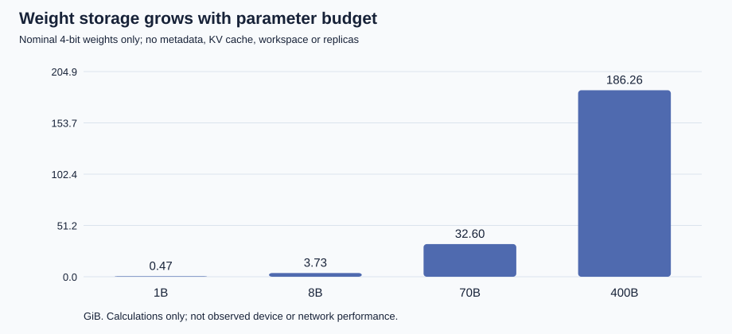
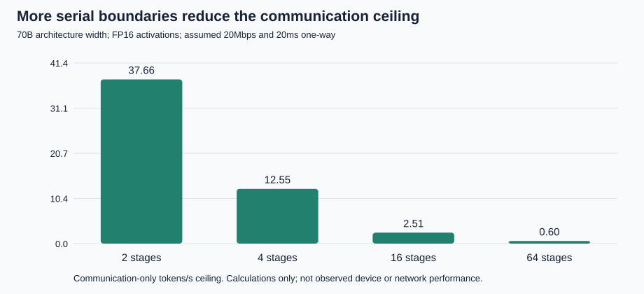

# Can a Consenting Household Device Mesh Support Distributed AI Inference?
## A bounded resource-feasibility study

**Project:** Household Compute  
**Status:** theoretical research draft and reproducible analytical extension, 22 October 2026. Not a peer-reviewed paper.  
**Scope:** inference and divisible computational work on fully informed, consenting owners' devices. No household device, cross-host network, new model or deployment was exercised for this extension.

## Abstract

Could a highly capable AI divide a computationally demanding inference workload across everyday devices, even when the available hardware is heterogeneous and links are poor? The meaningful version of this question is bounded: specify a workload, quality requirement, latency or throughput target, eligible device inventory, memory budgets, sustained service rates, link conditions and availability assumptions. Without such bounds, a worst case includes total disconnection or zero usable memory and is trivially impossible. We develop a necessary-condition framework separating aggregate capacity, valid shard placement, critical-path latency, steady-state throughput and continuity of service. Illustrative 1B, 8B, 70B and 400B parameter budgets are storage/work scales, not labels for intelligence. Ideal nominal 4-bit weights alone occupy 0.466, 3.725, 32.596 and 186.265 GiB, respectively. For a documented 70B architecture, an explicitly assumed runtime envelope at 8,192 context tokens occupies 43.616 GiB, implying four households only if each contributes 12 GiB of simultaneously allocatable, eligible memory. This count does not establish placement or speed. In a separate serial 16-stage scenario, FP16 boundaries over assumed 20 Mbps payload links with 20 ms one-way latency impose approximately 0.398 seconds of communication per token before computation, a communication-only ceiling of 2.511 tokens/s. Existing single-host partition, transport and cached-decode experiments establish narrow numerical correctness and accounting facts, not household feasibility. Published distributed-inference studies establish that model sharding can work on specified hardware, but not that all networked appliances are useful inference workers. The proposal is conditionally plausible for selected devices and suitable task decompositions; robust interactive execution on arbitrary household inventories remains unestablished.

**Keywords:** heterogeneous inference; pipeline parallelism; memory capacity; autoregressive decoding; edge computing; bounded worst case; fully informed consent.

## 1. Research question and contribution

The question is not whether intelligence can make insufficient hardware physically sufficient. It is whether a capable planner can select a valid decomposition, placement and schedule within the resources that actually exist. A planner might choose better algorithms, smaller validated models, different precision, suitable experts, independent subtasks, batching, redundant workers or better routes. Each change must be evaluated against the same requested task and quality requirement. Replacing a model with a smaller one without checking quality is not evidence that the original workload became feasible.

We ask:

> Given a fully consenting, technically eligible household-device mesh and bounded adverse operating conditions, is there a decomposition and schedule that can execute a specified inference workload with acceptable memory use, quality, latency, throughput and completion probability?

This paper contributes: (1) a resource and eligibility model that makes that question testable; (2) reproducible memory, communication, straggler and availability sensitivity calculations; (3) an evidence ledger separating manufacturer specifications, published measurements, project measurements, assumptions and unknowns; and (4) falsifiable next experiments. It does not propose device intrusion, bypassing platform restrictions, automatic device enrollment or an unrestricted network service. Complete informed consent is assumed throughout, rather than treated as a missing condition. Consent does not itself supply an application runtime, memory allocator, accelerator kernel, physical interconnect or sustained duty cycle.

A positive answer to one case is existential: some consenting configuration can work. A worst-case guarantee is universal over a defined uncertainty set and is substantially stronger. Conversely, failure of one small controller or codec does not prove that every possible decomposition is impossible.

## 2. Related work and the relevant distinctions

### 2.1 Model distribution is already possible under specified conditions

Petals distributes contiguous transformer blocks across participating GPU servers and addresses node loss using server-side KV state and client-side cached inputs. Its original study includes both controlled network settings and geographically distributed operation. For Llama 2 70B NF4 on three 16 GB T4 GPUs, Table 2 reports 2.29 sequential steps/s at 100 Mbit/s with RTT below 5 ms and 1.57 at RTT 100 ms. Those are measured results for the paper's hardware, model, sequence length 128 and protocol, not a forecast for televisions, refrigerators or phones. This is constructive evidence against a blanket claim that Internet-linked inference is impossible, while preserving network and memory constraints. [R1]

MDI-LLM studies model-distributed edge inference using three Jetson TX2 boards, each with 8 GB shared RAM, connected by gigabit Ethernet. Its recurrent pipeline processes multiple independent sequences. The useful lesson is that distributing resident model state can enable otherwise oversized workloads, and that throughput and single-sequence latency are different objectives. The paper's hardware comparison does not establish the available memory or sustained performance of any particular smartphone. [R2]

PagedAttention/vLLM treats the growing, per-request KV cache as a separate serving-resource problem and reduces allocation waste. This supports explicitly accounting for sequence length and concurrent requests rather than treating a weights file as total runtime memory. It does not make KV bytes disappear or validate its kernels on heterogeneous household devices. [R3]

### 2.2 Four different meanings of “subdivide the compute”

| Decomposition | What is divided | Potential benefit | Necessary constraint or limitation |
|---|---|---|---|
| Pipeline/model parallelism | Different layers or model components on different workers | Larger model can fit across workers; concurrent requests can fill pipeline | A single autoregressive stream must traverse dependent stages; local weights, KV and workspace must fit |
| Tensor parallelism | A layer's matrix operations across workers | Can reduce a layer's compute time | Frequent collectives/synchronization and compatible kernels; not described by a single activation hop per stage |
| Task/request parallelism | Independent requests, preprocessing, search branches or independent tools | Aggregate throughput; useful work on small devices | Does not combine separate small model memories into one larger resident model; result-merging and verification cost remain |
| Mixture-of-experts routing | Selective expert computation within an explicitly trained architecture | Fewer active parameters per token than total stored parameters | Total expert residency, routing imbalance, dispatch/return and worst-case expert demand remain |

Mixtral provides an architectural example of the last distinction: its original report describes 47B total parameters and 13B active per token, with two selected feedforward experts per layer. Active arithmetic is not total weight storage; a router's expert choices may change between tokens. Fetch-on-demand shifts some residency cost into transfer latency rather than eliminating it. This is not equivalent to asking independent AIs to exchange text. [R4]

A fifth layer, orchestration, chooses decompositions, validates eligibility, estimates resources, schedules work and combines outputs. Orchestration can make a feasible plan better or find a plan a fixed heuristic misses. Its own inference, coordination, retries, state replication and verification consume resources. In this paper the planner is not assumed to be an additional free 400B model already running elsewhere. Any such planner's measured or bounded cost must be included in a complete system budget.

## 3. Evidence, assumptions and what “household” means

### 3.1 Evidence classes

Every quantitative claim belongs to one of five classes:

- **Manufacturer exemplar (V):** installed capacity or advertised peak of a named device/configuration. It is not spare capacity or sustained workload performance.
- **Published measurement (M):** a research or manufacturer benchmark with its stated workload and setup. Generalization beyond that setup is not assumed.
- **Project measurement (P):** retained local experiment described in Section 8. Timing repetitions are not independent hardware or quality trials.
- **Hypothetical assumption/calculation (A):** an explicitly selected budget, link setting, arithmetic model or availability distribution. A sensitivity range is not a confidence interval.
- **Unknown (U):** no verified quantity in the inspected evidence. Unknown resources are uncredited, not declared physically nonexistent.

Sources were inspected on 22 October 2026. Versioned papers are cited by the version actually read. Living specifications may change; source dates and scope are listed in Section 12. The existing [household atlas](../HOUSEHOLD_ATLAS.md) preserves a broader device list and earlier scenario tables. This paper adds analysis rather than rewriting its measurements.

### 3.2 Named exemplars, not a synthetic average device

| Named exemplar and evidence class | Publicly documented resource | What is not established for this study |
|---|---|---|
| MacBook Air 13-inch M4, 2025 (V) | 16 GB unified memory; configurable to 24 or 32 GB; advertised 120 GB/s memory bandwidth [R5] | Free application memory, sustained model bandwidth, thermal behavior, shard performance |
| Google Pixel 9, 2024 (V) | 12 GB RAM; Tensor G4 [R6] | Allocatable memory, background execution eligibility, sustained dense-model throughput |
| Fire TV Stick 4K Max, second generation, 2023 (V) | 2 GB LPDDR4; four Cortex-A55 cores up to 2.0 GHz [R7] | Spare RAM, model kernels, useful LLM latency while preserving normal playback |
| Xbox Series X, 2020 (V) | 16 GB GDDR6; advertised GPU peak 12 TFLOPS [R8] | A supported arbitrary distributed-inference runtime or any credited application memory budget |
| ESP32-S3 SoC (V) | 512 KB internal SRAM; two Xtensa LX7 cores up to 240 MHz; external memory support [R9] | Exact board/external-memory configuration, available SRAM, or LLM tokens/s |
| Smart refrigerator, robot vacuum, smart display (U for usable inference resources here) | Product functionality does not determine an addressable inference allocation | Exact SoC generation, memory pools, sustained operations, runtime eligibility and safe duty cycle |

GB and KB above retain manufacturer labels; GiB below means exactly 2^30 bytes. Unified memory, separate host RAM, GPU VRAM, SRAM and flash are not interchangeable or automatically additive. A unified pool must not be counted again as both CPU and GPU capacity. Clock frequency, core count, GPU TFLOPS and precision-dependent NPU TOPS cannot be summed into a validated cross-device FLOP rate. The Xbox peak is not credited as eligible compute. No capability unlocking or platform bypass is assumed. MCU-sized resources may be valuable for preprocessing, sensing or coordination without contributing material large-model weight capacity.

The 2021 American Community Survey reports household presence of desktop/laptop computers at 80.5%, smartphones at 90.0% and tablets at 63.8%, in a report published June 2024. These overlapping presence statistics do not determine device counts, model generations, RAM or simultaneous availability. We derive no national available-compute estimate from them. [R10]

### 3.3 Device-informed hypothetical memory baskets

We retain the atlas's 4, 12 and 24 GiB sensitivities. The 12 GiB case is one selected 16 GB M4 laptop contributing an assumed 8 GiB and two selected 12 GB Pixel 9 phones contributing an assumed 2 GiB each; the 24 GiB case selects a 32 GB laptop at 16 GiB plus two phones at 4 GiB each. These are chosen configurations and allocations, not observed free-memory amounts or a conversion of vendor GB into GiB. The 4 GiB row is simply a smaller allocatable-budget sensitivity in the new calculations.

The 12 and 24 GiB basket labels alone do not certify three workers can host a chosen partition. Both allocation limits and the maximum indivisible component need checking on each worker.

A “household” in the count calculations is a bundle contributing that assumed total. It is not one CPU, one address space, one model stage or one independent failure domain. Cross-home sharding might introduce several device boundaries per home. Conversely, multiple consecutive stages may reside on one powerful device. Counts only become stage counts in the separate, explicitly named one-stage-per-household topology.

## 4. Formal problem and bounded adverse conditions

Let the inference workload be a dependency graph G with operations v, required state, and communication edges e. A candidate plan assigns operations and state to devices i, specifies a numerical format and valid runtime, and schedules tasks and transfers. Each device has eligible, simultaneously addressable memory m_i, an operation-specific service model f_i, an availability schedule a_i(t), and a duty-cycle/thermal constraint. Each directed link has effective payload bandwidth R_e, one-way latency L_e and contention behavior. Rates are workload-specific, not sums of incompatible marketing peaks.

A service target is a tuple: fixed task distribution and quality criterion Q; maximum time to first token; maximum or percentile per-token latency; aggregate completed-work throughput; request horizon; and required completion probability. Tail percentiles require measured distributions, not merely mean values. In the deterministic tests below, only the explicitly computed quantities are asserted.

A robust feasibility claim would require a valid plan for every state in a declared uncertainty set U, or an adaptive policy that completes under every admissible sequence of states. An unrestricted worst case allows no connected eligible worker and is uninformative. We instead propose the following bounded stress design:

| Stress factor | Bounded scenario for analysis or a future trial | Required measurement before a guarantee |
|---|---|---|
| Heterogeneous memory | Total assumed 4/12/24 GiB per bundle; every indivisible shard still must fit a specific pool | Minimum safe allocatable memory per eligible worker and placement audit |
| Link degradation | Fixed illustrative effective payload settings 1,000/20/5 Mbps and one-way latency 1/20/100 ms | Directed transfer distributions, contention, protocol and relay accounting |
| Straggler | Four hypothetical stages at 20 ms each; one may slow to 100 ms, no slower in this toy case | Sustained stage service times including format conversion and cache access |
| Limited duty cycle | Example worker service allowance 25% or 50%, never interpreted as a latency guarantee by itself | Duration/alignment of service windows, preemption, recovery and energy limits |
| Availability | Explicit per-node probabilities 0.90/0.99 under an independence model; contrast common-mode failures | Joint failure process, redundancy placement, replacement readiness and repair time |
| Runtime eligibility | Only operator/format/device combinations demonstrated through a supported runtime receive capacity | API/operator support, allocation limits and validated numerical output |

These are a scenario family, not evidence that any actual home satisfies those bounds. For a deterministic request guarantee, a sufficient service contract must also bound maximum outage and provide an execution window long enough for the request, or bound preemptions and state-restoration cost. A 25% duty cycle alone permits badly misaligned windows in which no end-to-end pipeline is usable. Positive average capacity is not sufficient for bounded response time.

For ranges R in [R_min,R_max] and L in [L_min,L_max], the most adverse communication component in the simple fixed-chain model uses R_min and L_max. This is a scenario evaluation, not a floor that applies to every better link state. If an admissible stress state already violates a necessary latency condition, that proposed robust service target is ruled out. Passing all the necessary conditions below does not prove a sufficient schedule exists.

## 5. Resource derivations

### 5.1 Weight capacity is a first floor, not a system budget

For P stored parameters at nominal q bits per weight,

    W_ideal = P q / 8 bytes.

This is an ideal storage floor for representing those weights in that stipulated fixed-width scheme, not an information-theoretic lower bound for every possible compression or different model. At nominal 4-bit, quantization scales, zero points, padding and mixed-precision tensors are excluded. For example, the documented llama.cpp Q4_K block representation uses 4.5 bits per weight, before file-level and mixed-tensor effects. A 70B all-Q4_K arithmetic surrogate therefore occupies 36.671 GiB rather than 32.596 GiB. No actual 70B file size is asserted. Lower-bit formats also need compatible kernels, dequantization workspace and model/task-specific quality evaluation. Weight quantization and boundary-activation quantization are separate interventions. [R11]

For aggregate assumed memory B per bundle,

    H_weight = ceil(W_ideal / B).

This is a conditional memory-only household count. Total memory is necessary but not sufficient: four indivisible 3 GiB shards cannot fit into pools of 8, 2 and 2 GiB, even though both totals equal 12 GiB. The 8 GiB pool holds only two such shards and each 2 GiB pool holds none. Different permitted partitioning could change that example; it must be demonstrated, not silently assumed. Embedding/output-head placement, tied-weight duplication, device reserves and inaccessible pools can create additional constraints.

### 5.2 KV cache, workspace and replication

For an ordinary resident, uncompressed grouped-query KV cache,

    K = 2 × layers × KV_heads × head_dimension × context_tokens
        × concurrent_sequences × bytes_per_KV_element.

The leading two stores both keys and values. This tensor-byte expression excludes allocator fragmentation, page tables, padding, framework objects and temporary attention buffers. It does not apply unchanged to compressed, sliding-window, latent-attention or recomputed-state designs.

For documented Llama 3.1 architecture examples, layers are 32/80/126, KV heads are eight, and head dimension is 128. At 8,192 context tokens, one sequence and FP16 KV, K is 1/2.5/3.9375 GiB for 8B/70B/405B. This uses actual architecture examples rather than inventing a KV layout for the generic 1B or 400B budgets. [R12]

To preserve the earlier atlas comparison we calculate a separate illustrative envelope:

    M_example = 1.20 W_ideal + K + 2 GiB.

The 20% multiplier and 2 GiB aggregate reserve are analyst choices, not measured format or runtime requirements, and not per-device reserves. This expression is neither an upper bound on real allocation nor a proof that a particular checkpoint fits. A real plan needs stage-specific W_i + K_i + workspace_i + runtime_i <= m_i, plus coordinator state, replication and simultaneous concurrency. Replicating a stage multiplies its resident weights and possibly caches; independently serving more requests grows cache state. Memory retained only in slower storage must be budgeted separately from the memory used by active kernels.

### 5.3 Computation and the critical path

For a specified implementation with exact work C and an upper bound F on useful operation throughput, elapsed compute time is at least C/F. For a dependency graph, no schedule can beat its operation/communication critical path. A planner may change the algorithm subject to the fixed quality target, but cannot erase the dependencies of the chosen algorithm by assigning more workers.

The familiar approximately 2P floating-point operations per token is a **dense active-matrix arithmetic surrogate**, counting multiply/add as two operations. It is not an exact FLOP count from total checkpoint parameters: embeddings, weight sharing, attention against the context, sparse operations, output projection and kernel details must be counted from the architecture. Our compute table deliberately assumes all P budgeted parameters participate as dense matrix weights, then reports this surrogate. At 5 tokens/s, the 1B/8B/70B/400B scales correspond to approximately 0.010/0.080/0.700/4.000 TFLOP/s of this work, before the omitted costs. No device is assigned those sustained rates.

Even with known rates, 2P divided by the sum of device FLOP/s can be a very loose resource bound. In an unbatched serial layer pipeline, with stage compute times c_i, the compute contribution is sum(c_i), not C/sum(F_i). Several devices holding disjoint layers are not simultaneously executing the same dependent token. Tensor parallelism and independent requests have different schedules.

Memory movement can be binding instead of arithmetic. If a stipulated decode implementation streams W_i bytes from a device memory pool for every token at effective bandwidth beta_i, that stage needs at least W_i/beta_i seconds of such movement. Caching, batching and reuse change the bytes moved; a bandwidth-derived bound must state those assumptions. The advertised laptop bandwidth is not measured beta_i and cannot be substituted as achieved model throughput.

### 5.4 Communication, prefill and serial decoding

For a simple chain of k contiguous-layer stages, one independent autoregressive sequence, one FP16 vector of width d per boundary and no relay, define A = 2d bytes. Under fixed effective payload rates R_j and one-way latencies L_j, the ideal non-overlapped communication component is

    T_comm = sum over k−1 boundaries (L_j + A / R_j).

A uniform-link surrogate becomes (k−1)(L + A/R). Payload Mbps converts to bytes/s as Mbps × 10^6 / 8. Adding serial stage compute gives T_token >= sum(c_i) + T_comm under these stipulated dependencies and store-and-forward boundary transfers. The reciprocal of T_comm is only a communication-derived upper ceiling on token rate for this model; it is not predicted speed. Initial model distribution, sampling/return-to-input-stage, queueing, serialization, encryption, packet overhead, relay duplication, contention and failure recovery add cost. A relay through the coordinator requires counting every directed transfer, rather than treating it as a direct hop.

The per-token ceiling is scoped to this declared one-token decoding graph/protocol, not to every strategy a capable AI might choose. Speculative decoding can propose several tokens with a draft process and verify candidates in a target-model pass, changing the number of accepted tokens per sequential target evaluation; exact-distribution guarantees require the method's stated acceptance/sampling rules. Multi-token prediction can also change the graph but needs a compatible model and quality evaluation. Such alternatives add draft/model residency, candidate verification, acceptance-rate variability and possibly extra communication. They must be modeled and measured separately; dividing this table's time by an assumed block length would not establish their speed. Independent tasks or requests change utilization without removing a particular stream's dependencies. None of these alternatives was executed here. [R13]

Prefill is different: it processes many prompt tokens and can parallelize matrix work. For a whole-prompt, nonstreaming, store-and-forward implementation with S tokens, a boundary sends S A bytes. Chunking and streaming can overlap transfers/computation, so summing full-prompt transfers is not a universal prefill lower bound. Time to first token must include the actual prefill schedule and any cold model loading. Cached decoding avoids repeatedly computing the full prefix, but retains growing KV state on its owning stages.

### 5.5 Aggregate throughput, stragglers and duty cycle

With sufficiently many independent sequences and suitable buffering, an ideal pipeline's aggregate token throughput cannot exceed 1/max(s_i), where s_i includes a stage's relevant service and communication obligations. This is a bottleneck ceiling, not a guaranteed achieved rate. Shared links, memory contention, routing imbalance, synchronization, pipeline bubbles and finite request counts can lower it.

For example, four hypothetical 20 ms compute stages have 80 ms total serial compute and a compute-stage-only throughput ceiling of 50 tokens/s. Replacing one stage with a 100 ms straggler changes those to 160 ms and 10 tokens/s. With the four-stage assumed 20 Mbps/20 ms communication component added, the corresponding ideal single-stream ceilings become 6.263 and 4.173 tokens/s. The compute-stage-only 50/10 values do not include network service and must not be quoted as mesh throughput.

A device delivering useful sustained work f_i only during fraction u_i of a window has at most u_i f_i average service over that window under that accounting. Summing those averages may constrain throughput but does not prove latency or aligned availability. Background household functions take precedence in any concrete budget; no inference headroom or safe thermal load has been measured here.

### 5.6 Availability is a joint property

If k necessary stages each have independent probability a of being ready for the specified service window, chain readiness is a^k. If each stage has r independent ready replicas and stages are also independent, it is [1−(1−a)^r]^k. These are conditional probability models, not measured household reliability. Two replicas require additional residency and replacement state; readiness alone does not bound recovery latency.

At a=0.90, four/16/64 unreplicated stages yield approximately 65.61%/18.53%/0.118% readiness. Under a perfectly common all-up/all-down event with the same marginal a, readiness is instead 90% for any chain length. Other dependence structures give other outcomes. Household power, shared Wi-Fi, Internet access and correlated sleeping/usage make independence an assumption requiring evidence. Redundancy on the same failure domain may provide little protection. A single-time readiness statistic is not a request-completion probability unless it represents readiness over the complete required interval.

## 6. Analytical results

All new numeric results in this section are class A calculations from [the offline script](../calculations/feasibility.py). They are not new model or device measurements. JSON/CSV tables retain full precision; prose is rounded.

### 6.1 Parameter-budget storage sensitivity

| Stored parameter budget | Ideal 4-bit GiB | Ideal 8-bit GiB | Ideal 16-bit GiB | Conditional 4-bit homes at 12 GiB/home |
|---|---:|---:|---:|---:|
| 1B | 0.466 | 0.931 | 1.863 | 1 |
| 8B | 3.725 | 7.451 | 14.901 | 1 |
| 70B | 32.596 | 65.193 | 130.385 | 3 |
| 400B | 186.265 | 372.529 | 745.058 | 16 |

A “400B” row is a rounded budget, not a claim about a specific model's capability, architecture or available checkpoint. The 405B architecture-based envelope below is a separate exact scenario label and is not silently renamed 400B.

### 6.2 Conditional household counts, with preserved atlas assumptions

Each cell is **weight-only count / illustrative-envelope count**, using nominal 4-bit weights, FP16 KV at context 8,192 and batch one, and M_example from Section 5.2.

| Architecture example | 4 GiB/home assumed | 12 GiB/home assumed | 24 GiB/home assumed |
|---|---:|---:|---:|
| 8B | 1 / 2 | 1 / 1 | 1 / 1 |
| 70B | 9 / 11 | 3 / 4 | 2 / 2 |
| 405B | 48 / 59 | 16 / 20 | 8 / 10 |

For 70B, W_ideal=32.596 GiB, K=2.5 GiB and M_example=43.616 GiB (unrounded: 43.6155481338501 GiB). For 405B, M_example=232.249 GiB. These reproduce the original 12 GiB headline counts. They are conditional lower-count resource scenarios under ideal pooling, not national household estimates and not practical upper bounds. The generated 27-row table also includes nominal 8-bit and 16-bit formats. More homes can supply more bytes while increasing coordination and serial communication. No single count optimizes both constraints automatically.

### 6.3 Context and concurrency can dominate the residual budget

For the 70B architecture example and FP16 KV:

| Context tokens | One sequence KV GiB | Four concurrent sequences KV GiB |
|---:|---:|---:|
| 2,048 | 0.625 | 2.500 |
| 8,192 | 2.500 | 10.000 |
| 32,768 | 10.000 | 40.000 |
| 131,072 | 40.000 | 160.000 |

These are tensor bytes only. Increasing context or concurrency can invalidate an allocation that appeared comfortable from weights alone. Cache distribution follows layer ownership; it cannot simply be assigned to unrelated spare memory without communication and runtime consequences.

### 6.4 Communication-derived ceilings, not token-rate forecasts

The following independent sensitivity uses width d=8,192, one FP16 vector per boundary and k stages. Each setting is hypothetical effective payload bandwidth / one-way latency. No compute or feedback-return cost is included.

| Stages k | 1,000 Mbps / 1 ms ceiling, tokens/s | 20 Mbps / 20 ms ceiling, tokens/s | 5 Mbps / 100 ms ceiling, tokens/s |
|---:|---:|---:|---:|
| 2 | 884.117 | 37.660 | 7.923 |
| 4 | 294.706 | 12.553 | 2.641 |
| 16 | 58.941 | 2.511 | 0.528 |
| 64 | 14.034 | 0.598 | 0.126 |

The table is valid for at most the available contiguous-layer stages; 64 is below the selected model's 80 layers. It is not a tensor-parallel collective model. A 16-stage chain at the middle setting already exceeds a 200 ms/token budget on communication alone, so that particular five-token/s single-stream target is impossible under this stipulated state, even with free computation. A four-stage chain passes that necessary communication check but may still fail on compute, memory, runtime or return traffic. This is why a storage count cannot be promoted into a performance forecast.

## 7. Methods and reproducibility

The extension is deterministic and uses Python's standard library only. It performs arithmetic, unit tests and local file generation. It does not import a model runtime, contact a device, open a listener, execute a distributed workload, install a package or change network configuration. No real-device or real-model execution was added.

From the repository root after integrating this paper:

    python calculations/feasibility.py
    python -m unittest discover -s tests -p test_feasibility.py -v

The script generates seven CSV tables, one JSON package, a concise Markdown table file and two SVG charts. Exact Fraction arithmetic is used for weight bytes and household ceilings; displayed rates use floating-point arithmetic and are rounded only in presentation. Input validation rejects nonfinite, negative and invalid dimensions. The nine new test methods cover unit conversions, exact ceiling boundaries, KV scaling, link/hop counts, stragglers, conditional availability, invalid inputs, table coverage/legacy consistency and byte-identical output regeneration. Those methods contain multiple assertions; they are not nine hardware trials. All nine passed in the author's local Python 3.12 environment on 22 October 2026. The retained output is [calculation-tests.txt](../research/calculation-tests.txt).

The analytical outputs include an evidence-kind flag. No timing is benchmarked by the calculation script. Source dimensions and assumptions are versioned in the paper and script; no automatic scraping changes the analytical inputs during reproduction. Original project measurements remain in their existing result files. The public-source baseline inspected for this synthesis is commit e4880cf710863be982caf8c908a86801dd37e4fe; new documentation must not be mistaken for a rerun of that baseline.

## 8. Existing project measurements and their limits

These results predate this analytical extension. They are class P, single-host studies, and should remain distinguishable from both published research and new calculations.

| Study | What was actually exercised | Retained result | What it does not establish |
|---|---|---|---|
| [Persistent-process synthetic suite](../REPEATED_EXPERIMENT.md) | Two local workers, fixed dense/ReLU workload, widths 8/32/64, two link assumptions, seven retained pairs/case | 42 pairs matched exactly. Width64 no-delay median split 1.548 ms vs reference 0.913 ms; emulated-link split 19.039 ms | Real model quality, heterogeneous-device scaling, actual network performance or speedup |
| [Pinned 135M pretrained partition repeat](../PRETRAINED_RESULTS.md) | Same-host CPU FP32 forward pass through two workers, two prefixes, three retained samples/condition | Exact logits on retained pairs. At 18 tokens, no-delay split 111.84 ms vs reference 101.37 ms | Autoregressive token rate, real network latency, broad task quality or memory savings |
| [Activation transport study](../studies/transport-codecs/TRANSPORT_RESULTS.md) | 216 paired samples, 12 fixed prefixes, three boundary formats, two assumed links, three timing repetitions | FP16 matched reference next-token choice 12/12 with small logit drift; tested whole-tensor INT8 matched 0/12 despite smaller frames | General INT8 failure, general model accuracy, or physical-link performance |
| [Cached decode](../studies/cached-decode/CACHED_RESULTS.md) | Two retained same-host runs; four prefills and 32 cached decode comparisons/run, including reset/replay | All 72 paired rows had byte-exact reference logits; split decode medians 74.99/71.31 ms versus 67.94/65.62 ms reference | A memory-saving system, cross-host inference, robust interruption recovery or household throughput |
| [Source-only framing codec](../studies/tcp-framing-codec/README.md) | Deterministic in-memory protocol/accounting tests; no actual sockets or models in that slice | 34 passing test methods in retained record; synthetic token/audit forecasts 4,872/201,480 application bytes per decode | TCP behavior, blocked-socket cancellation, full inference correctness, deployment or permission to execute future tests |

In cached decode each worker retained its own layer-local KV state. A single-token activation had 2,304 payload bytes, but full-vocabulary FP32 audit logits had 196,608 payload bytes per step, dominating total IPC. The topology relayed activations through the controller, so one logical stage boundary involved two actual IPC paths. The tied embedding/output matrix was duplicated, and the controller also held a complete reference model. No aggregate memory-saving claim follows. A future final-stage token return could reduce traffic, but is not a measurement in that experiment.

The transport study's whole-tensor INT8 negative result concerns one residual-stream transport quantizer, not all weight or activation quantization. Its repetitions do not multiply the number of distinct quality examples. Likewise, exactness on small fixed prefixes is valuable evidence for partition correctness, not a demonstration of intelligence or language-task usefulness. These studies show why accounting and output validation are necessary before scaling, and why a smaller message can be scientifically worse if it corrupts the computation.

## 9. What would make the proposal plausible, implausible or unknown?

**Plausible for a defined case:** eligible devices have enough stage-local memory, supported kernels and sustained throughput; a quality-validated model/format fits; a small number of low-latency stages meets the measured critical-path budget; or independent tasks provide useful aggregate throughput without tight cross-device dependence. Published multi-device systems establish that this category is real, not that every device is suitable. A capable planner could add value by finding these decompositions and excluding unsuitable workers.

**Implausible or ruled out for a defined target:** ideal storage already exceeds available eligible memory with no permitted offload; an indivisible required tensor or operator cannot be placed; an unavoidable critical-path transfer exceeds the latency budget; measured sustainable compute is inadequate; required stages cannot stay available for the service horizon; or the chosen compression fails the predeclared quality criterion. Adding many tiny unsupported devices is not a remedy for these conditions. A monolithic workstation or smaller quality-validated model may be a stronger comparison than a larger mesh.

**Still unknown:** exact usable resources of most appliances; prevalence of compatible devices and simultaneously idle memory; quantized-kernel support across OS/device families; sustained thermal and incremental energy costs; realistic link-tail behavior; recovery costs; scheduler optimality under churn; and whether the proposed workload actually benefits from distributed execution versus a simpler baseline. An unknown is a research task, not a license to assign an optimistic constant.

These conclusions concern resources and a stipulated task, not an upper limit on intelligence. Parameter count alone neither defines capability nor measures the quality of an orchestration strategy. Demonstrating a 1B workload's distribution does not establish a 400B workload's feasibility; demonstrating 400B storage does not establish human-level, frontier-level or any other capability category.

## 10. Falsifiable research program

No tests in this section have been run as part of this extension. Each requires a prospective protocol and the applicable authorization before device/network/model execution.

1. **Inventory and eligibility audit.** Record exact model/configuration, distinct memory pools, supported runtime/operators, OS allocation/background constraints and predeclared household-function reserves. Reject capacity credit for an unvalidated pool. Falsify a proposed basket if any required allocation or operator cannot be supported without exceeding its declared budget.
2. **Single-device sustained characterization.** Pin checkpoint, revision, numerical formats, context, concurrency and output criterion. Separately measure cold load, prefill, steady cached decode, local cache/workspace and incremental wall energy while preserving ordinary device duties. Falsify the compute assumption if the predeclared sustained bound is missed. Do not infer performance from advertised TOPS.
3. **Directed transport and accounting test.** Compare token-return and full-logit audit modes, recording every directed application transfer and measured wire traffic separately. Exercise bounded contention, delayed/partial I/O and declared latency/bandwidth regimes. Falsify the communication model if required bytes or tail delays exceed the assumed service contract. Synthetic framing success is not a substitute.
4. **Cross-device equivalence and quality gate.** Compare exact or prospectively tolerated logits/tokens with a monolithic reference and a fixed representative task evaluation. Freeze calibration, prompts and thresholds before outcomes. Reject formats that save bandwidth while missing the quality/equivalence target. Retain all failures, rather than replacing difficult examples.
5. **Bounded straggler/duty-cycle trial.** Predeclare stage slowdowns, minimum continuous service windows and maximum outage/repair limits. Compare measured single-request latency with aggregate throughput as separate endpoints. Falsify a claimed robust target if any admissible tested stress schedule violates it. A finite test cannot prove every possible schedule, so pair trials with a verified scheduling argument when making universal claims.
6. **Availability and recovery trial.** Distinguish independent node loss, household-wide outages and shared-link failures. Measure state rebuild, redundant weight/cache residency and the time needed to resume the same request. Reject a completion guarantee that depends only on marginal uptime or assumes free replacement.
7. **Planner-value ablation.** Under identical inventory, task quality, resource budgets and permitted information, compare the capable planner against static best-device routing, a measured simple partitioner, and independent-request assignment. Charge all planning/verification work and model residency. A useful planner should improve a predeclared feasible-service frontier, not merely select an easier task or report more aggregate peak FLOPS.

Report completed requests, time-to-first-token, per-token latency distribution, aggregate throughput, quality, actual local peak memory, application/wire bytes, failures and incremental energy. Keep analytical predictions, emulated delays and physical observations in different fields. Numerical correctness, deployment readiness and practical value are separate acceptance gates.

## 11. Limitations

This is necessary-condition analysis with constructed sensitivities, not a population estimate or a sufficient feasibility proof. Ideal fixed-width weight arithmetic ignores possible alternative compression but also many real allocation costs. The chosen envelope is illustrative. The serial-chain network model is intentionally simple, excludes return/relay/collective details and does not cover every architecture. The dense arithmetic surrogate is not a checkpoint profiler. The availability examples assume distributions not measured in homes. Neither stage service rates nor real device free-memory budgets were measured here.

The existing local studies use a small pinned model, a shared CPU host, fixed prefixes and short timing repetitions. Their exactness results are narrow; timing noise and audit overhead limit inference about performance. Existing future-study designs and source-only protocol tests are not execution evidence. No claim is made about real residential links, off-the-shelf appliance programmability, a national average compute pool, training feasibility or a highly capable system's achievable intelligence.

Full consent remains part of the stipulated setting. A real implementation would still need a concrete enrollment, revocation, resource-isolation and data-protection design, because consenting participation does not automatically make activations, prompts, cached state or model weights confidential. This draft does not implement that design or transmit any such data.

## 12. Sources and evidence dates

All sources below were inspected 22 October 2026. Dates refer to the named publication/version, not the date of any new project measurement. Vendor pages are exemplars rather than a sample of household hardware. Targeted retrieval was used for vendor/Census facts; full primary paper text or the original abstract was inspected for the research claims.

- **R1, published measured study:** Borzunov et al., *Distributed Inference and Fine-tuning of Large Language Models Over The Internet*, arXiv:2312.08361v1, December 2023. Architecture, dual-cache recovery and Table 2 settings/results. [Original paper](https://arxiv.org/html/2312.08361v1).
- **R2, published edge-system study:** Macario, Seferoglu and Koyuncu, *Model-Distributed Inference for Large Language Models at the Edge*, arXiv:2505.18164v1, May 2025. Exact testbed and multi-sequence recurrent-pipeline framing. [Original paper](https://arxiv.org/html/2505.18164v1).
- **R3, published serving study:** Kwon et al., *Efficient Memory Management for Large Language Model Serving with PagedAttention*, arXiv:2309.06180v1, September 2023; SOSP 2023. KV state, fragmentation and scheduling. [Original paper](https://arxiv.org/html/2309.06180v1).
- **R4, original architecture report:** Jiang et al., *Mixtral of Experts*, arXiv:2401.04088, submitted 8 January 2024. Original abstract: total/active parameter distinction and expert selection. [Original abstract](https://arxiv.org/abs/2401.04088).
- **R5, manufacturer exemplar:** Apple, *MacBook Air (13-inch, M4, 2025)—Tech Specs*. Model-year 2025, living support page; exact installed memory and advertised bandwidth, not inference measurements. [Manufacturer specification](https://support.apple.com/en-us/122209).
- **R6, manufacturer exemplar:** Google, *Pixel phone hardware tech specs*, Pixel9 entry. Model-year 2024, living support page; RAM/processor only. [Manufacturer specification](https://support.google.com/pixelphone/answer/7158570?hl=en).
- **R7, manufacturer exemplar:** Amazon, *Device Specifications: Fire TV Streaming Media Player*, second-generation 4K Max 2023 entry. Living developer page; exact device row. [Manufacturer specification](https://developer.amazon.com/docs/device-specs/device-specifications-fire-tv-streaming-media-player.html).
- **R8, manufacturer exemplar:** Xbox Wire, *Xbox Series X: A Closer Look at the Technology Powering the Next Generation*, 16 March 2020. Installed memory/advertised GPU peak; does not establish an arbitrary inference runtime. [Manufacturer article](https://news.xbox.com/en-us/2020/03/16/xbox-series-x-tech/).
- **R9, manufacturer exemplar:** Espressif, *ESP32-S3*. Living SoC page; internal SRAM/core/clock specifications, not a board-specific available-memory or LLM benchmark. [Manufacturer specification](https://www.espressif.com/en/products/socs/esp32-s3).
- **R10, official population evidence:** U.S. Census Bureau, *Computer and Internet Use in the United States: 2021*, ACS-56, June 2024. 2021 household device-presence statistics, not device capabilities. [Original report](https://www2.census.gov/library/publications/2024/demo/acs-56.pdf).
- **R11, implementation-format evidence:** ggml/llama.cpp, *Tensor Encoding Schemes*, living wiki. Q4_K 4.5 bits/weight encoding; not a promise about a complete mixed-tensor checkpoint. [Original implementation documentation](https://github.com/ggml-org/llama.cpp/wiki/Tensor-Encoding-Schemes).
- **R13, original algorithm report:** Leviathan, Kalman and Matias, *Fast Inference from Transformers via Speculative Decoding*, arXiv:2211.17192, originally November 2022. Multi-candidate draft/target verification with distribution-preserving sampling under the algorithm's assumptions; not a household-mesh measurement. [Original abstract](https://arxiv.org/abs/2211.17192).
- **R12, original model-architecture report:** Llama Team, *The Llama 3 Herd of Models*, arXiv:2407.21783v3, 23 November 2024, Table 3. Representative dimensions for memory calculations; no parameter-count definition of intelligence. [Original paper, Table 3](https://arxiv.org/html/2407.21783v3#S3.T3).

## Appendix A. Reproducible output index

- [All analytical tables and units, JSON](../results/feasibility_tables.json)
- [Short regenerated tables, Markdown](../results/feasibility_tables.md)
- [Weight floors, CSV](../results/feasibility_weight_floors.csv)
- [Memory/precision/basket sensitivity, CSV](../results/feasibility_memory_sensitivity.csv)
- [Communication sensitivity, CSV](../results/feasibility_communication.csv)
- [Dense-matrix budget surrogate, CSV](../results/feasibility_dense_matmul_budget.csv)
- [KV context/concurrency sensitivity, CSV](../results/feasibility_kv_sensitivity.csv)
- [Straggler sensitivity, CSV](../results/feasibility_synthetic_stage_sensitivity.csv)
- [Conditional availability, CSV](../results/feasibility_availability.csv)
- [Offline tests](../tests/test_feasibility.py)

## Appendix B. Interpretation checklist

Before describing a mesh as feasible, state: feasible for which task and quality threshold; with which checkpoint/format; on which technically eligible memory pools; with what exact shard placement; under which directed-link and service-window bounds; at what single-request latency and aggregate throughput; with what replication/recovery budget; and with what measured sustained power/thermal cost. If an answer is missing, label the conclusion conditional or unknown instead of filling the gap with a household average.
